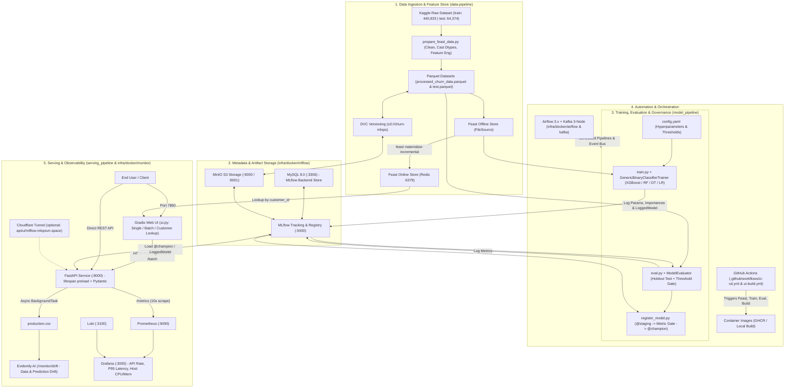

# Customer Churn Prediction System — End-to-End MLOps Project Documentation

> **System Scope:** Production-grade MLOps platform covering data versioning (**DVC + MinIO**), feature engineering & online/offline serving (**Feast + Redis**), multi-model training & registry governance (**XGBoost / scikit-learn + MLflow**), CI/CD automation (**GitHub Actions**), containerized inference & UI (**FastAPI + Gradio**), and full-stack observability (**Evidently AI + Prometheus + Grafana + Loki**), deployable via **Docker Compose** or **Kubernetes**.

---

## 1. Executive Summary & 2-Minute Elevator Pitch

### Business Problem Statement
Subscription businesses lose recurring revenue rapidly when customers silently disengage and cancel (**churn**). Retaining an existing customer is significantly cheaper than acquiring a new one, so identifying at-risk subscribers early allows retention teams to intervene with targeted outreach, plan adjustments, or support resolution.

In churn prediction, classification errors carry asymmetric business costs:
- **False Negative (Missed Churner):** A customer who will churn is predicted as `Active (0)`. No retention offer is sent, resulting in **lost Customer Lifetime Value (CLV)** and higher future Customer Acquisition Cost (CAC) to replace them.
- **False Positive (False Alarm):** A loyal customer is predicted as `Churn (1)`. The business incurs the **unnecessary cost of a retention incentive** (e.g., discount or outreach), though the customer stays.
- **Operational Impact:** Prioritizing **Recall** on the churn class protects revenue, while balancing **Precision / F1-score** prevents retention budgets from being wasted on false alarms.

### 2-Minute Conversational Elevator Pitch
> *"I built an end-to-end MLOps platform for customer churn prediction that takes raw customer behavior and demographic records all the way from versioned datasets to a monitored, containerized prediction service.*
>
> *On the data side, I versioned raw and processed datasets with DVC backed by MinIO S3 storage, and standardized feature definitions in a Feast feature store—using Parquet for offline training and Redis for low-latency online feature retrieval.*
>
> *For modeling, I built a config-driven Python training and evaluation framework supporting XGBoost, Random Forest, Decision Tree, and Logistic Regression. Every training run logs hyperparameters, feature importances, and a custom `BinaryClassifierWrapper` (which bundles label encoders and enforces schemas) into MLflow, backed by MySQL and MinIO. Models go through automated evaluation on a held-out test set, threshold gating, and alias-based promotion (`@staging` → `@champion`) in the MLflow Model Registry.*
>
> *For serving, I built a FastAPI microservice (`POST /predict/`, `POST /predict/batch`, `/health/`, `/monitor/drift`, `/metrics`) alongside a 3-tab Gradio web UI. Incoming predictions are logged asynchronously to a production CSV for Evidently AI data/prediction drift monitoring, while Prometheus scrapes FastAPI and host metrics into pre-provisioned Grafana dashboards. Everything runs reproducibly via Docker Compose—with Kubernetes manifests, a 3-broker Kafka cluster, Airflow 3.x orchestration stack, and GitHub Actions CI/CD workflows ready for scale."*

### Repository Layout Map

```text
aio2025-mlops-project01/
├── requirements.txt                                  # Unified root Python dependencies (installable via uv pip install -r requirements.txt)
├── README.md                                         # Quick-start guide and architecture overview
├── PROJECT_DOCUMENTATION.md                          # Comprehensive engineering & interview documentation (this file)
├── .github/workflows/
│   ├── ci-cd.yml                                     # Self-hosted CI/CD: Feast apply/materialize -> Train -> Eval -> Register/Promote -> Build/Push API
│   └── ui-build.yml                                  # Path-triggered CI workflow to build/push Gradio UI image to GHCR
├── cloudflare_tunnel/
│   ├── build_tunnel.md                               # Guide for exposing MLflow, API, and UI securely via Cloudflare Tunnel
│   └── config.yml                                    # Cloudflared ingress routing (mlflow/ui/api.mlopsvn.space)
├── data-pipeline/
│   ├── .dvc/config & config.local                    # DVC remote configuration pointing to S3 / local MinIO (s3://churn-mlops/churn-data)
│   ├── data/raw/                                     # Raw Kaggle CSVs (training: 440,833 rows; testing: 64,374 rows) + .dvc pointers
│   ├── data/processed/                               # Cleaned & engineered CSV (df_processed.csv, 440,832 rows) + .dvc pointer
│   ├── scripts/processing+EDA.ipynb                  # Exploratory data analysis, outlier/null checks, and initial CSV preprocessing
│   ├── scripts/check_id.py                           # Sanity check for unique customer IDs in processed Parquet
│   ├── scripts/sample_retrieval.py                   # Script verifying online feature retrieval from Feast + Redis
│   └── churn_feature_store/churn_features/feature_repo/
│       ├── feature_store.yaml                        # Feast config (local registry, file offline store, Redis online store)
│       ├── churn_entities.py                         # Customer entity definition (join key: customer_id)
│       ├── data_sources.py                           # FileSource pointing to data/processed_churn_data.parquet
│       ├── feature_views.py                          # customer_demographics, customer_behavior, and churn_target FeatureViews
│       ├── prepare_feast_data.py                     # Deterministic CLI/module converting raw/processed CSVs into Feast-ready Parquet
│       └── data/                                     # Feature store registry.db, processed_churn_data.parquet, test.parquet, .dvc pointers
├── model_pipeline/
│   └── src/
│       ├── config/                                   # YAML configs: config.yaml (XGBoost), random_forest.yaml, decision_tree.yaml, logistic_regression.yaml
│       ├── data/                                     # Preprocessing notebooks (preprocess.ipynb, advanced_preprocessed.ipynb)
│       ├── mlflow_utils/experiment_tracker.py        # Wrapper around MlflowClient for experiment setup, nested runs, params/metrics/artifacts
│       ├── mlflow_utils/model_registry.py            # Model registration, alias management (@staging/@champion), and metric-gated promotion
│       ├── model/xgboost_trainer.py                  # GenericBinaryClassifierTrainer (XGBoost, RF, DT, LR) + BinaryClassifierWrapper pyfunc
│       ├── model/evaluator.py                        # ModelEvaluator using mlflow.models.evaluate, SHAP config, thresholds, baseline comparison
│       ├── scripts/train.py                          # CLI entrypoint for model training and MLflow logging
│       ├── scripts/eval.py                           # CLI entrypoint for holdout evaluation, threshold checks, and prediction CSV export
│       ├── scripts/register_model.py                 # CLI for registering MLflow LoggedModels, aliasing, promoting, and inspecting models
│       ├── run_sh/                                   # Bash automation scripts (train.sh, eval.sh, register.sh, set_model_alias.sh, promote.sh, list_model.sh, model_info.sh)
│       ├── utility/helper.py                         # YAML configuration loader
│       └── tests/                                    # Pytest fixtures (conftest.py), unit tests, and integration/e2e test stubs
├── serving_pipeline/
│   ├── Dockerfile & Dockerfile.ui                    # Container definitions for FastAPI backend and Gradio frontend
│   ├── docker-compose.yml                            # Serving stack orchestration (churn-prediction-api + churn-prediction-ui on aio-network)
│   ├── requirements.txt & .env.example               # Minimal serving dependencies and portable Docker environment template
│   ├── load_model.py                                 # Loads pyfunc model from MLflow Tracking/Registry URI
│   ├── pre_processing.py                             # Schema mapping (Title_Case -> snake_case), range/category validation, production logging
│   ├── monitoring.py                                 # Evidently AI DataDriftPreset / ClassificationPreset report & metric generator
│   ├── sample_retrieval.py                           # Online feature lookup from data-pipeline Feast repo for Gradio Tab 3
│   ├── ui.py                                         # 3-tab Gradio UI (Single Prediction, Batch CSV Prediction, Customer Feature Store Lookup)
│   ├── test.py                                       # Evidently binning & age drift visualization analysis script
│   └── api/
│       ├── main.py                                   # FastAPI app, startup model pre-loading (lifespan), CORS, and Prometheus /metrics endpoint
│       ├── schemas.py                                # Pydantic v2 contracts (ChurnInput, ChurnPrediction, HealthResponse, DriftMetricsResponse)
│       └── routers/                                  # predict.py (/predict/, /predict/batch), health.py (/health/, /ready, /live), monitor.py (/monitor/drift)
└── infra/
    ├── docker/
    │   ├── run.sh                                    # Unified CLI (up, down, restart, status) managing all 4 Docker Compose stacks
    │   ├── mlflow/                                   # MLflow server + MySQL 8.0 metadata store + MinIO S3 storage + bucket init (mc)
    │   ├── kafka/                                    # 3-node Kafka 8.0.0 cluster in KRaft mode (ports 9092, 9192, 9292)
    │   ├── monitor/                                  # Prometheus + Grafana (auto-provisioned datasources & dashboard) + Loki + Node/DCGM Exporters
    │   └── airflow/                                  # Airflow 3.1.1rc1 (API server, scheduler, dag-processor, Celery worker, triggerer, Postgres 16, Redis 7.2)
    └── k8s/
        ├── deploy.sh & teardown.sh                   # Automated Kubernetes deployment & teardown scripts for mlops namespace
        └── namespace.yaml, postgres/, minio/, mlflow/, kafka/, airflow/, dashboard/  # Production-style K8s manifests & PVCs
```

---

## 2. End-to-End System Architecture

### Architecture Diagram



### Step-by-Step Data & Control Flow Walkthrough

1. **Raw Ingestion & Cleaning:** Raw customer records from Kaggle (`customer_churn_dataset-training-master.csv`, 440,833 rows; `customer_churn_dataset-testing-master.csv`, 64,374 rows) are cleaned in [processing+EDA.ipynb](file:///Users/arpitparmar/Projects/MLME%20MLOPS%20Project/Churn%20Prediction%20System/aio2025-mlops-project01/data-pipeline/scripts/processing+EDA.ipynb) (dropping 1 null row, casting types) and standardized via [prepare_feast_data.py](file:///Users/arpitparmar/Projects/MLME%20MLOPS%20Project/Churn%20Prediction%20System/aio2025-mlops-project01/data-pipeline/churn_feature_store/churn_features/feature_repo/prepare_feast_data.py). This outputs schema-aligned `processed_churn_data.parquet` and `test.parquet` with 19 Feast-compatible columns.
2. **Data Versioning & Feature Store Materialization:** DVC tracks raw CSVs and processed Parquet files in MinIO (`s3://churn-mlops/churn-data`). `feast apply` registers the `customer` entity and three FeatureViews (`customer_demographics`, `customer_behavior`, `churn_target`), and `feast materialize-incremental` loads recent feature values into Redis (`localhost:6379`).
3. **Config-Driven Training & Model Packaging:** [train.py](file:///Users/arpitparmar/Projects/MLME%20MLOPS%20Project/Churn%20Prediction%20System/aio2025-mlops-project01/model_pipeline/src/scripts/train.py) reads [config.yaml](file:///Users/arpitparmar/Projects/MLME%20MLOPS%20Project/Churn%20Prediction%20System/aio2025-mlops-project01/model_pipeline/src/config/config.yaml), encodes categorical features with `LabelEncoder` on the training dataframe, performs a stratified 80/20 split, and trains via `GenericBinaryClassifierTrainer` in [xgboost_trainer.py](file:///Users/arpitparmar/Projects/MLME%20MLOPS%20Project/Churn%20Prediction%20System/aio2025-mlops-project01/model_pipeline/src/model/xgboost_trainer.py). The trained estimator and fitted `feature_encoders` are wrapped in `BinaryClassifierWrapper` (`mlflow.pyfunc.PythonModel`) and logged to MLflow (`MySQL` metadata + `MinIO` artifacts).
4. **Holdout Evaluation & Registry Promotion:** [eval.py](file:///Users/arpitparmar/Projects/MLME%20MLOPS%20Project/Churn%20Prediction%20System/aio2025-mlops-project01/model_pipeline/src/scripts/eval.py) evaluates the logged model against `test.parquet` using `mlflow.models.evaluate` and validates configured metric thresholds (`accuracy_score`, `f1_score`). [register_model.py](file:///Users/arpitparmar/Projects/MLME%20MLOPS%20Project/Churn%20Prediction%20System/aio2025-mlops-project01/model_pipeline/src/scripts/register_model.py) registers the MLflow 3.x `LoggedModel` (`models:/m-<id>`), assigns `@staging`, and promotes to `@champion` only if the candidate outperforms the current champion on `f1_score`.
5. **Containerized Serving & Feature Lookup:** On startup, FastAPI ([main.py](file:///Users/arpitparmar/Projects/MLME%20MLOPS%20Project/Churn%20Prediction%20System/aio2025-mlops-project01/serving_pipeline/api/main.py)) calls `predict.get_model()` inside `lifespan()` to pre-load the MLflow model into memory (fail-fast). Requests arrive either directly at `POST /predict/` or `/predict/batch`, or via the Gradio UI ([ui.py](file:///Users/arpitparmar/Projects/MLME%20MLOPS%20Project/Churn%20Prediction%20System/aio2025-mlops-project01/serving_pipeline/ui.py)), which can also fetch real-time customer features from Redis via [sample_retrieval.py](file:///Users/arpitparmar/Projects/MLME%20MLOPS%20Project/Churn%20Prediction%20System/aio2025-mlops-project01/serving_pipeline/sample_retrieval.py).
6. **Observability & Drift Feedback Loop:** Each prediction validates bounds/types via Pydantic (`ChurnInput`) and `validate_input()`, casts numeric columns to match MLflow schema enforcement, and schedules `save_production_data()` as a FastAPI `BackgroundTask` to append records to `production.csv`. `GET /monitor/drift` runs Evidently AI (`DataDriftPreset` / `ClassificationPreset`) against reference data to generate JSON metrics or HTML reports, while Prometheus scrapes `/metrics` every 10s to power Grafana visualizations.

---

## 3. Techniques, Methodologies & ML Pipeline Deep Dive

### Data Preprocessing & Leakage Prevention
- **Missing Value Handling & Cleaning:** Raw training data (`440,833` rows) contains 1 corrupted/null row (`12` null cells across all columns); both [processing+EDA.ipynb](file:///Users/arpitparmar/Projects/MLME%20MLOPS%20Project/Churn%20Prediction%20System/aio2025-mlops-project01/data-pipeline/scripts/processing+EDA.ipynb) and [prepare_feast_data.py](file:///Users/arpitparmar/Projects/MLME%20MLOPS%20Project/Churn%20Prediction%20System/aio2025-mlops-project01/data-pipeline/churn_feature_store/churn_features/feature_repo/prepare_feast_data.py) apply `.dropna()`, yielding `440,832` clean training rows and `64,374` clean test rows (`0` outliers detected via IQR/Z-score check in EDA).
- **Schema Standardization & Type Enforcement:** Raw Title-Case columns (`Age`, `Tenure`, `Usage Frequency`, etc.) are mapped to Feast snake_case names (`age`, `tenure_months`, `usage_frequency`, etc.). Explicit casting (`int64` for `age`, `tenure_months`, `support_calls`, `last_interaction_days`, `churned`; `float64` for `usage_frequency`, `payment_delay_days`, `total_spend`) prevents MLflow schema enforcement errors when integers appear in raw test CSVs.
- **Feature Engineering:** [prepare_feast_data.py](file:///Users/arpitparmar/Projects/MLME%20MLOPS%20Project/Churn%20Prediction%20System/aio2025-mlops-project01/data-pipeline/churn_feature_store/churn_features/feature_repo/prepare_feast_data.py) computes row-wise domain ratios (`tenure_age_ratio`, `spend_per_usage`, `support_calls_per_tenure`, `avg_monthly_spend`, `churn_risk_score`) independently per record, avoiding cross-row data leakage. While EDA experimented with `pd.qcut` (`Spending_Group`), quantile-based binning was excluded from `training_features` so test evaluation never leaks population distribution statistics.
- **Categorical Encoding & Scaling:** [train.py](file:///Users/arpitparmar/Projects/MLME%20MLOPS%20Project/Churn%20Prediction%20System/aio2025-mlops-project01/model_pipeline/src/scripts/train.py) fits `LabelEncoder` on `gender` (`Male`/`Female`), `subscription_type` (`Basic`/`Standard`/`Premium`), and `contract_length` (`Monthly`/`Quarterly`/`Annual`), bundling the fitted `feature_encoders` inside `BinaryClassifierWrapper`. Tree-based models (`XGBoost`, `RandomForest`, `DecisionTree`) do not require feature scaling; for `LogisticRegression`, `max_iter: 1000` is configured in [logistic_regression.yaml](file:///Users/arpitparmar/Projects/MLME%20MLOPS%20Project/Churn%20Prediction%20System/aio2025-mlops-project01/model_pipeline/src/config/logistic_regression.yaml) *(note: adding `StandardScaler` inside a scikit-learn `Pipeline` is a recommended V2 enhancement for linear models)*.
- **Train/Test Separation:** Evaluation in [eval.sh](file:///Users/arpitparmar/Projects/MLME%20MLOPS%20Project/Churn%20Prediction%20System/aio2025-mlops-project01/model_pipeline/src/run_sh/eval.sh) is strictly pointed at the separate `test.parquet` (`64,374` rows), never `processed_churn_data.parquet` (`440,832` rows), eliminating training-set evaluation leakage.

### Class Imbalance & Metric Prioritization
- **Dataset Class Balance (Observed):**
  - **Training dataset (`processed_churn_data.parquet`, 440,832 rows):** `249,999` Churn (`56.71%`) vs. `190,833` Active (`43.29%`) — moderately imbalanced toward churn.
  - **Testing dataset (`test.parquet`, 64,374 rows):** `30,493` Churn (`47.37%`) vs. `33,881` Active (`52.63%`) — notice the label shift (`~9.3%` drop in churn base rate between train and test).
- **Imbalance Mitigation:**
  - Stratified train/validation splitting (`stratify=y` in `GenericBinaryClassifierTrainer.prepare_data`).
  - `class_weight: "balanced"` enabled in [random_forest.yaml](file:///Users/arpitparmar/Projects/MLME%20MLOPS%20Project/Churn%20Prediction%20System/aio2025-mlops-project01/model_pipeline/src/config/random_forest.yaml), [decision_tree.yaml](file:///Users/arpitparmar/Projects/MLME%20MLOPS%20Project/Churn%20Prediction%20System/aio2025-mlops-project01/model_pipeline/src/config/decision_tree.yaml), and [logistic_regression.yaml](file:///Users/arpitparmar/Projects/MLME%20MLOPS%20Project/Churn%20Prediction%20System/aio2025-mlops-project01/model_pipeline/src/config/logistic_regression.yaml).
  - Decision-threshold support built into `BinaryClassifierWrapper` (currently `0.5`, returning both `probability` and `prediction` when `return_both=True` is passed).
- **Metric Prioritization:** Instead of relying solely on raw accuracy, `ModelEvaluator` and `ModelRegistry.promote_model()` track `f1_score`, `precision_score`, `recall_score`, and full confusion matrix counts (`true_positives`, `false_negatives`, `false_positives`, `true_negatives`). In churn prediction, `recall_score` minimizes missed churners while `f1_score` guards against flooding retention campaigns with false positives.

### Model Selection, Hyperparameters & Validation Strategy
- **Multi-Algorithm Framework:** `GenericBinaryClassifierTrainer` ([xgboost_trainer.py](file:///Users/arpitparmar/Projects/MLME%20MLOPS%20Project/Churn%20Prediction%20System/aio2025-mlops-project01/model_pipeline/src/model/xgboost_trainer.py)) standardizes four classifiers behind a single config-driven interface:
  1. **XGBoost (`XGBClassifier`, active in [config.yaml](file:///Users/arpitparmar/Projects/MLME%20MLOPS%20Project/Churn%20Prediction%20System/aio2025-mlops-project01/model_pipeline/src/config/config.yaml)):** `n_estimators: 200`, `max_depth: 6`, `learning_rate: 0.1`, `subsample: 0.8`, `colsample_bytree: 0.8`, `objective: "binary:logistic"`, `eval_metric: "logloss"`.
  2. **Random Forest (`RandomForestClassifier`):** `n_estimators: 200`, `max_depth: 20`, `min_samples_split: 10`, `min_samples_leaf: 4`, `oob_score: true`, `class_weight: "balanced"`.
  3. **Decision Tree (`DecisionTreeClassifier`):** `max_depth: 15`, `min_samples_split: 20`, `min_samples_leaf: 10`, `ccp_alpha: 0.01`, `class_weight: "balanced"`.
  4. **Logistic Regression (`LogisticRegression`):** `penalty: "l2"`, `C: 1.0`, `solver: "lbfgs"`, `max_iter: 1000`, `class_weight: "balanced"`.
- **Two-Stage Validation Strategy:**
  - **Stage 1 (In-Distribution Holdout):** Stratified 80/20 split inside `train.py` (`352,665` train / `88,167` val).
  - **Stage 2 (Separate Test Dataset + Threshold Gate):** `eval.py` evaluates registered/run models on `test.parquet` (`64,374` rows), enforces `evaluation.thresholds` (`accuracy_score >= 0.80`, `f1_score >= 0.80`), optionally logs SHAP explainers, and supports side-by-side comparison (`--compare-baseline`).
  - **Recorded XGBoost Metrics (from MLflow Experiment `2`):**

| Evaluation Scope | Accuracy | F1 Score | Precision | Recall | Confusion Matrix (TP / FN / FP / TN) | ROC-AUC |
| :--- | :---: | :---: | :---: | :---: | :---: | :---: |
| **80/20 Stratified Val Split** (`train.py`, run `48d98538...`) | `0.999921` | `[INSERT METRIC: Val F1]` | `[INSERT METRIC: Val Precision]` | `[INSERT METRIC: Val Recall]` | `[INSERT METRIC: Val Confusion Matrix]` | `[INSERT METRIC: Val ROC-AUC]` |
| **Holdout Test Set** (`test.parquet`, 64,374 rows, run `33e29f14...`) | `0.503386` | `0.655785` | `0.488170` | `0.998688` | `30,453` / `40` / `31,929` / `1,952` | `[INSERT METRIC: Test ROC-AUC]` |

> **Engineering Diagnostic Note:** The contrast between `99.99%` accuracy on the in-distribution split and `50.34%` accuracy (`99.87%` recall, `48.82%` precision) on `test.parquet` reflects **dataset distribution shift** between the Kaggle training and testing CSVs—a critical real-world signal that triggers threshold gates and motivates Evidently drift monitoring. Top logged feature importances were `total_spend` (`0.2754`), `support_calls` (`0.2396`), `payment_delay_days` (`0.2057`), `contract_length` (`0.0894`), and `age` (`0.0825`).

### Reproducibility Practices
- **Deterministic Randomness:** `random_state: 42` enforced across splits and all estimator configs.
- **Config-Driven Runs:** All MLflow URIs, features, thresholds, and hyperparameters are externalized in `model_pipeline/src/config/*.yaml`.
- **Data & Artifact Lineage:** DVC tracks `.csv` and `.parquet` hashes in MinIO; MLflow logs parameters, metrics, model signatures (`infer_signature`), input examples, and `code_paths` (`model_pipeline/src/`) into MinIO + MySQL.
- **Environment Parity:** Containerized runtimes via `Dockerfile` / `Dockerfile.ui`, root `requirements.txt` verified via `uv pip compile`, and pinned `sqlalchemy<2.1` in MLflow's container.

---

## 4. Tech Stack Matrix ("What" & "Why")

| Layer / Component | Technology Used | Why It Was Chosen | Alternatives Considered |
| :--- | :--- | :--- | :--- |
| **ML Frameworks** | `XGBoost`, `scikit-learn`, `SHAP` | XGBoost excels on tabular binary classification; scikit-learn provides unified metrics, encoders, and fast baseline models (`RF`, `DT`, `LR`); SHAP adds feature-level explainability. | LightGBM, CatBoost, PyTorch Tabular |
| **Feature Store & Online Cache** | `Feast` (File offline + `Redis` online) | Eliminates training-serving feature skew by sharing entity/view definitions (`churn_entities.py`, `feature_views.py`) and serving sub-millisecond customer lookups from Redis. | Custom SQL/Redis scripts, Tecton, Hopsworks |
| **Data Versioning** | `DVC` + `dvc-s3` (backed by `MinIO`) | Keeps large CSV/Parquet files out of Git while preserving Git-linked dataset MD5 pointers (`.dvc`) against S3-compatible object storage. | Git LFS, LakeFS, Delta Lake |
| **Experiment Tracking & Registry** | `MLflow` (`MySQL 8.0` + `MinIO`) | Industry-standard open-source tracking, `pyfunc` packaging (bundling encoders + code), model evaluation APIs, and `@staging`/`@champion` alias governance. | Weights & Biases, Neptune.ai, ClearML |
| **API & Serving Layer** | `FastAPI` + `Uvicorn` + `Pydantic v2` | Async Python performance, automatic OpenAPI/Swagger docs (`/docs`), strict request/response validation (`ChurnInput`), and `BackgroundTasks` for non-blocking logging. | Flask, BentoML, Triton Inference Server |
| **Interactive Web UI** | `Gradio` | Rapidly exposes single prediction sliders, batch CSV uploads, and Feast online feature lookups in one Python module (`ui.py`) without building a separate JS frontend. | Streamlit, React + TypeScript |
| **Data & Model Drift Monitoring** | `Evidently AI` (`>=0.4.33,<0.7.0`) | Out-of-the-box statistical drift tests (`DataDriftPreset`) and classification performance reports (`ClassificationPreset`) returning both JSON APIs and HTML reports. | WhyLogs, Arize Phoenix, NannyML |
| **Infra Observability** | `Prometheus` + `Grafana` + `Loki` + `Node Exporter` | Scrapes FastAPI `/metrics` (`prometheus-fastapi-instrumentator`) and host metrics; auto-provisioned Grafana dashboards visualize request rates, P95 latency, CPU, and memory. | Datadog, New Relic, ELK Stack |
| **Orchestration & Streaming** | `Apache Airflow 3.x` (CeleryExecutor) + `Kafka 8.0.0` (KRaft, 3-node) | Airflow provides scheduled DAG execution with Postgres + Redis; 3-broker KRaft Kafka provides ZooKeeper-free event streaming infrastructure for future real-time pipelines. | Prefect, Dagster, RabbitMQ |
| **Containerization & Deployment** | `Docker`, `Docker Compose`, `Kubernetes` (`infra/k8s/`), `Cloudflare Tunnel` | Compose enables reproducible local multi-stack development (`infra/docker/run.sh`); K8s manifests provide production cluster parity; Cloudflare Tunnel exposes local services without opening firewall ports. | ECS/Fargate, Helm Charts, Terraform + EKS |
| **CI/CD Automation** | `GitHub Actions` (self-hosted runners) | Automates Feast materialization, training, evaluation, registry promotion, and Docker Buildx image pushes to GHCR on merges to `main`. | GitLab CI, Jenkins, ArgoCD |

---

## 5. Engineering Trade-Offs & Design Decisions

### 1. Packaging Preprocessing (`LabelEncoder`) Inside `BinaryClassifierWrapper` vs. External Preprocessing Service
- **Decision Made:** Wrapped `LabelEncoder` instances (`feature_encoders`) and column selection inside an `mlflow.pyfunc.PythonModel` (`BinaryClassifierWrapper` in [xgboost_trainer.py](file:///Users/arpitparmar/Projects/MLME%20MLOPS%20Project/Churn%20Prediction%20System/aio2025-mlops-project01/model_pipeline/src/model/xgboost_trainer.py)).
- **Pros:** Guarantees zero training-serving encoding drift; FastAPI (`predict.py`) only needs to map column names and pass a raw DataFrame to `model.predict()`.
- **Cons:** Couples the saved MLflow artifact to `model_pipeline/src` via `code_paths`, requiring dependencies like `loguru` inside the serving container and matching Python/library versions.
- **Revisit at 10x Scale:** Replace `cloudpickle`-serialized `PythonModel` wrappers with a pure ONNX/native XGBoost + `sklearn.pipeline.Pipeline` exported cleanly without `code_paths` source coupling.

### 2. Real-Time REST API + Batch Endpoint vs. Pure Batch Pipeline
- **Decision Made:** Built synchronous REST serving (`/predict/` and `/predict/batch` up to 1,000 rows in [predict.py](file:///Users/arpitparmar/Projects/MLME%20MLOPS%20Project/Churn%20Prediction%20System/aio2025-mlops-project01/serving_pipeline/api/routers/predict.py)) plus Redis online feature lookup.
- **Pros:** Enables real-time CRM/UI checks (customer support agents querying a customer ID in Gradio) while still supporting bulk CSV scoring.
- **Cons:** `/predict/batch` loops row-by-row inside Python (`for idx, data in enumerate(data_list):`), which underutilizes XGBoost's vectorized batch inference and blocks the worker on large payloads.
- **Revisit at 10x Scale:** Vectorize `/predict/batch` into a single `model.predict(df_batch)` call, and offload >1,000-row jobs to an async Kafka consumer / Spark batch scoring DAG in Airflow.

### 3. Self-Hosted Open-Source MLOps Stack vs. Managed Cloud Services
- **Decision Made:** Self-hosted the full stack (`MLflow`, `MinIO`, `MySQL`, `PostgreSQL`, `Redis`, `Kafka`, `Airflow`, `Prometheus`, `Grafana`, `Loki`) via Docker Compose and K8s manifests.
- **Pros:** Zero cloud vendor lock-in, zero recurring cloud bills during development, and full control over networking, schemas, and debugging.
- **Cons:** High operational overhead (maintaining container upgrades, volume migrations, healthchecks, and multi-arch image builds across 15+ containers).
- **Revisit at 10x Scale:** Migrate stateful infrastructure to managed cloud offerings (Amazon RDS for MySQL/Postgres, S3 instead of MinIO, MSK for Kafka, and EKS with Managed Prometheus/Grafana).

### 4. Multi-Repo-Style Modular Directories vs. Monolithic Package
- **Decision Made:** Separated `data-pipeline/`, `model_pipeline/`, `serving_pipeline/`, and `infra/` into independent directories with their own `requirements.txt` and `README.md` files, plus a unified root [requirements.txt](file:///Users/arpitparmar/Projects/MLME%20MLOPS%20Project/Churn%20Prediction%20System/aio2025-mlops-project01/requirements.txt).
- **Pros:** Clean separation of concerns; serving containers don't install `dvc` or `pyspark`, and teams can iterate on pipelines independently.
- **Cons:** Cross-pipeline shared logic (like preprocessing schemas in `prepare_feast_data.py` vs `serving_pipeline/pre_processing.py`) risks drifting out of sync without a shared internal Python package.
- **Revisit at 10x Scale:** Extract common schemas, validation rules, and preprocessing utilities into a versioned internal wheel (`churn-core`) published to a private PyPI/Artifact Registry.

### 5. Local Native `arm64` Serving Builds vs. Upstream `linux/amd64` GHCR Images
- **Decision Made:** Updated [serving_pipeline/docker-compose.yml](file:///Users/arpitparmar/Projects/MLME%20MLOPS%20Project/Churn%20Prediction%20System/aio2025-mlops-project01/serving_pipeline/docker-compose.yml) to build locally (`pull_policy: build`) from trimmed direct dependencies rather than pulling prebuilt `amd64`-only GHCR images.
- **Pros:** Native Apple Silicon execution without QEMU emulation overhead, matches local code edits immediately, and eliminates 200+ `pip freeze` packages (including Linux/CUDA-only `nvidia-nccl-cu12`).
- **Cons:** First-time local image builds take several minutes; CI workflows still target `linux/amd64` unless multi-arch Buildx (`linux/amd64,linux/arm64`) is enabled.
- **Revisit at 10x Scale:** Configure GitHub Actions `docker/build-push-action` to publish multi-arch manifests (`linux/amd64,linux/arm64`) to GHCR/ECR so both local Apple Silicon devs and cloud `amd64` K8s nodes pull verified, immutable digests.

### 6. Async CSV Production Logging vs. Streaming Events to Kafka
- **Decision Made:** Used FastAPI `BackgroundTasks` to append predictions to `production.csv` (`save_production_data` in [pre_processing.py](file:///Users/arpitparmar/Projects/MLME%20MLOPS%20Project/Churn%20Prediction%20System/aio2025-mlops-project01/serving_pipeline/pre_processing.py)) for Evidently drift analysis.
- **Pros:** Keeps inference latency low without introducing a blocking database or Kafka producer failure path inside `/predict/`.
- **Cons:** File-based CSV appending is not thread/process-safe under multiple Uvicorn workers (`--workers > 1`) and does not scale across multiple horizontally scaled API replicas.
- **Revisit at 10x Scale:** Publish prediction events asynchronously to the already-provisioned 3-node Kafka cluster (`infra/docker/kafka/`), and let a sink consumer write partitioned Parquet files to MinIO/S3 for scheduled Evidently drift jobs.

---

## 6. Challenges Faced & Engineering Solutions

| # | Challenge | Root Cause | Implemented Solution (with File References) |
| :- | :--- | :--- | :--- |
| 1 | **Train/Test Schema & Dtype Mismatch in MLflow Evaluation** | Training CSV (`df_processed.csv`) stored `usage_frequency`, `payment_delay_days`, and `total_spend` as `float64`, while raw test CSV had integer values read as `int64`. MLflow rejected `int64 -> float64` during `eval.py`. | Refactored [prepare_feast_data.py](file:///Users/arpitparmar/Projects/MLME%20MLOPS%20Project/Churn%20Prediction%20System/aio2025-mlops-project01/data-pipeline/churn_feature_store/churn_features/feature_repo/prepare_feast_data.py) to accept `--input`/`--output`, clean nulls, engineer features, and enforce identical `int64`/`float64` dtypes; pointed [eval.sh](file:///Users/arpitparmar/Projects/MLME%20MLOPS%20Project/Churn%20Prediction%20System/aio2025-mlops-project01/model_pipeline/src/run_sh/eval.sh) to `test.parquet`. |
| 2 | **MLflow 3.x Registry & S3 Endpoint Failures in Serving** | [register_model.py](file:///Users/arpitparmar/Projects/MLME%20MLOPS%20Project/Churn%20Prediction%20System/aio2025-mlops-project01/model_pipeline/src/scripts/register_model.py) hardcoded `runs:/<run_id>/model` instead of MLflow 3.x `LoggedModel` (`models:/m-...`). Additionally, `botocore` rejected `http://aio_minio:9000` due to the underscore in the container name. | Updated `register_model.py` to resolve `run.outputs.model_outputs[0].model_id`; updated [serving_pipeline/.env](file:///Users/arpitparmar/Projects/MLME%20MLOPS%20Project/Churn%20Prediction%20System/aio2025-mlops-project01/serving_pipeline/.env) and [.env.example](file:///Users/arpitparmar/Projects/MLME%20MLOPS%20Project/Churn%20Prediction%20System/aio2025-mlops-project01/serving_pipeline/.env.example) to use `http://minio:9000` and `models:/customer_churn_model@champion`. |
| 3 | **Feast Hijacking FastAPI Prometheus `/metrics`** | Loading the model/Feast inside `churn-prediction-api` set `PROMETHEUS_MULTIPROC_DIR=/tmp/feast_metrics_*`, causing `Instrumentator.expose()` to read from an empty `MultiProcessCollector` (`content-length: 0`). | Kept `Instrumentator().instrument(app)` and replaced `.expose(app)` in [serving_pipeline/api/main.py](file:///Users/arpitparmar/Projects/MLME%20MLOPS%20Project/Churn%20Prediction%20System/aio2025-mlops-project01/serving_pipeline/api/main.py) with an explicit `@app.get("/metrics")` returning `generate_latest(REGISTRY)`. |
| 4 | **MLflow Server Crash-Loop & Deprecated Docker Images** | `mlflow==3.5.0` pulled unpinned `sqlalchemy>=2.1`, breaking `FallbackAsyncAdaptedQueuePool`; official `minio/minio` & `minio/mc` images were removed from Docker Hub. | Pinned `sqlalchemy<2.1` in [infra/docker/mlflow/mlflow/requirements.txt](file:///Users/arpitparmar/Projects/MLME%20MLOPS%20Project/Churn%20Prediction%20System/aio2025-mlops-project01/infra/docker/mlflow/mlflow/requirements.txt); switched [infra/docker/mlflow/docker-compose.yaml](file:///Users/arpitparmar/Projects/MLME%20MLOPS%20Project/Churn%20Prediction%20System/aio2025-mlops-project01/infra/docker/mlflow/docker-compose.yaml) to `pgsty/minio:latest`, `pgsty/mc:latest` (with `--ignore-existing` bucket creation), and `pull_policy: build`. |
| 5 | **macOS / Apple Silicon Host Incompatibilities** | Monitoring stack required Linux `nvidia` runtime (`dcgm-exporter`), `loki` Docker logging plugin, and `,rslave` root mount propagation; `serving_pipeline` failed on `arm64` due to `amd64` images and `nvidia-nccl-cu12` in `requirements.txt`. | Isolated `dcgm-exporter` behind `profiles: ["gpu"]` and removed `,rslave` in [infra/docker/monitor/docker-compose.yaml](file:///Users/arpitparmar/Projects/MLME%20MLOPS%20Project/Churn%20Prediction%20System/aio2025-mlops-project01/infra/docker/monitor/docker-compose.yaml); trimmed [serving_pipeline/requirements.txt](file:///Users/arpitparmar/Projects/MLME%20MLOPS%20Project/Churn%20Prediction%20System/aio2025-mlops-project01/serving_pipeline/requirements.txt) and switched Compose to local `arm64` builds. |
| 6 | **Silent Lazy-Load Failures & Port Mismatches in Serving** | `predict.py` lazy-loaded the model only on the first `/predict/` call, masking broken URIs during `/health`; `ui.py` launched Gradio on port `7823` instead of exposed `7860`, and `sample_retrieval.py` omitted `data-pipeline/` in `repo_path`. | Added `predict.get_model()` to `lifespan()` in [main.py](file:///Users/arpitparmar/Projects/MLME%20MLOPS%20Project/Churn%20Prediction%20System/aio2025-mlops-project01/serving_pipeline/api/main.py) for fail-fast boot (`"model_loaded": true`); restored `server_port=7860` in [ui.py](file:///Users/arpitparmar/Projects/MLME%20MLOPS%20Project/Churn%20Prediction%20System/aio2025-mlops-project01/serving_pipeline/ui.py); fixed `repo_path` in [sample_retrieval.py](file:///Users/arpitparmar/Projects/MLME%20MLOPS%20Project/Churn%20Prediction%20System/aio2025-mlops-project01/serving_pipeline/sample_retrieval.py). |
| 7 | **Unconfigured Grafana Dashboards & Airflow DB Revision Skew** | Grafana booted with empty datasources/dashboards; Airflow Postgres volume had a stale Alembic revision (`d2f4e1b3c5a7`) incompatible with `3.1.1rc1`. | Added auto-provisioned Prometheus/Loki datasources and `churn_api_overview.json` in `infra/docker/monitor/grafana/provisioning/`; reset Airflow volume so `airflow-init` initialized a clean `3.1.1rc1` schema. |

---

## 7. Key Achievements & Production Readiness

### Measurable Engineering & ML Outcomes
- **End-to-End Automation:** Single-command infrastructure bootstrap (`infra/docker/run.sh up`), scriptable ML lifecycle (`train.sh` → `eval.sh` → `register.sh` → `set_model_alias.sh` → `promote.sh`), and automated CI/CD workflows (`.github/workflows/ci-cd.yml`, `ui-build.yml`).
- **Full Data & Model Lineage:** `440,832` processed training records and `64,374` test records tracked in DVC + MinIO, materialized to Redis via Feast (`38`-row online retrieval verified), with every run logged to MySQL + MinIO in MLflow.
- **Model Governance & Quality Gates:** Implemented metric-gated promotion (`ModelRegistry.promote_model()` blocks promotion if candidate `f1_score <= champion`) and threshold validation (`accuracy_score >= 0.80`, `f1_score >= 0.80`) which caught severe train/test distribution shift (`99.99%` val accuracy vs. `50.34%` accuracy / `99.87%` recall on `test.parquet`).
- **Production Serving & Observability:** FastAPI startup model pre-loading verified (`"model_loaded": true`), end-to-end `/predict/` verified, Evidently AI drift reporting (`/monitor/drift`), and Prometheus + Grafana live dashboards verified (`[INSERT METRIC: P95 API Inference Latency in ms]` and `[INSERT METRIC: Peak Requests Per Second]`).
- **Portability Across Environments:** Unified root [requirements.txt](file:///Users/arpitparmar/Projects/MLME%20MLOPS%20Project/Churn%20Prediction%20System/aio2025-mlops-project01/requirements.txt) resolving cleanly with `uv pip compile` (`260` packages), native Apple Silicon `arm64` Docker builds, and full Kubernetes manifests (`infra/k8s/`) ready for cluster deployment.

### Future Roadmap / V2 Improvements
1. **Airflow Automated Retraining & Drift-Triggered Loop:** Add concrete Python/Bash DAGs in `infra/docker/airflow/dags/` that poll `/monitor/drift`, trigger retraining when `overall_drift_score > 0.2`, and post Slack/Alertmanager alerts via Prometheus Alertmanager.
2. **Complete Pytest & CI Quality Gates:** Finish the stubbed integration/E2E tests in `model_pipeline/src/tests/` (`test_e2e.py`, `test_integration_training_pipeline.py`), add FastAPI `TestClient` contract tests, and gate `ci-cd.yml` on `pytest` + `ruff` passing before building images.
3. **Kafka-Backed Prediction Event Stream & Real-Time Feature Updates:** Wire FastAPI `/predict/` to publish prediction payloads asynchronously to the 3-node Kafka cluster (`infra/docker/kafka/`), replacing local `production.csv` file appends for multi-replica safety.
4. **Cross-Domain Generalization & Threshold Calibration:** Investigate the Kaggle train/test covariate shift, log `roc_auc` / probability calibration curves in `eval.py`, tune the decision threshold in `BinaryClassifierWrapper` to reduce the `31,929` false positives on `test.parquet`, and add `StandardScaler` inside a scikit-learn `Pipeline` for linear models.
5. **Security & Secrets Hardening:** Remove hardcoded MinIO credentials (`minio` / `minio123`) from `train.py` and `eval.py`, switch to environment variables / Kubernetes External Secrets, enable TLS via Ingress/Cloudflare Tunnel, and restrict FastAPI CORS `allow_origins`.

---

## 8. Interview Preparation Cheat Sheet

### Intuitive Analogy (For Non-Technical Stakeholders)
> *"Think of this system like a **smart airport security & maintenance operation for customer subscriptions**:*
> - *The **DVC + MinIO warehouse** is our climate-controlled archive where every historical passenger manifest is stamped and stored so we can always audit past decisions.*
> - *The **Feast + Redis express counter** keeps each customer's latest profile metrics pre-staged in fast memory so agents don't have to dig through archives at check-in.*
> - *The **MLflow control tower** tests new predictive models in a simulator (`@staging`), compares them strictly against our current best inspector (`@champion`), and only promotes them if they actually improve detection.*
> - *Finally, **FastAPI + Gradio** is the live front-desk scanner, while **Evidently, Prometheus, and Grafana** act as the control-room radar—alerting us the moment incoming customer behavior starts drifting away from what the model was trained to recognize."*

### Top 10 Deep-Dive Interview Questions & Strong Answers

1. **Q: Why did your XGBoost model achieve 99.99% accuracy during training (`train.py`) yet only 50.34% accuracy (with 99.87% recall and 48.82% precision) on `test.parquet` (`eval.py`)?**
   - **Answer:** This is a textbook example of **dataset/covariate shift** between the Kaggle training CSV (`440,832` rows, `56.71%` churn) and the separate test CSV (`64,374` rows, `47.37%` churn). Because the model was evaluated on a genuinely isolated holdout dataset (`test.parquet`) rather than leaking the training set, our MLflow threshold gate (`accuracy_score >= 0.80`, `f1_score >= 0.80`) caught this degradation immediately before promotion. To address it, we inspect feature drift via Evidently AI (`/monitor/drift`), calibrate decision thresholds using predicted probabilities, and retrain on combined/reweighted recent data.

2. **Q: How did you prevent training-serving skew in this project?**
   - **Answer:** Two mechanisms work together: (1) **Feast** defines the canonical schema (`churn_entities.py`, `feature_views.py`) so offline training (`processed_churn_data.parquet`) and online inference (`Redis` via `sample_retrieval.py`) read identically named and typed features; and (2) `BinaryClassifierWrapper` in `xgboost_trainer.py` bundles the exact train-fitted `LabelEncoder` objects inside the MLflow `pyfunc` artifact, while `prepare_feast_data.py` enforces consistent `int64`/`float64` dtypes for both training and test sets.

3. **Q: Why did you choose F1-score and Recall over plain Accuracy for churn prediction?**
   - **Answer:** In churn datasets, class distributions shift (`56.7%` vs `47.4%` here) and errors have asymmetric costs. A false negative loses an entire customer's lifetime value, whereas a false positive only costs a targeted retention outreach. Tracking `recall_score`, `precision_score`, `f1_score`, and raw confusion matrix counts (`TP/FN/FP/TN`) in `evaluator.py` and gating registry promotion on `f1_score` in `ModelRegistry.promote_model()` ensures we balance churn capture against retention budget waste.

4. **Q: Walk me through how `ModelRegistry.promote_model()` protects production from bad models.**
   - **Answer:** In `model_pipeline/src/mlflow_utils/model_registry.py`, `promote_model()` looks up the candidate model version's evaluation run (`tags.source_run_id`), extracts its `f1_score`, searches across registered versions for the current `@champion` model's `f1_score`, and **blocks promotion** if `require_improvement=True` and `candidate_metric <= champion_metric`. Only when the candidate strictly improves performance does it reassign the `@champion` alias cleanly.

5. **Q: What happens inside the FastAPI service (`serving_pipeline`) when a prediction request arrives?**
   - **Answer:** First, FastAPI pre-loads the MLflow model during startup `lifespan()` in `api/main.py` so the container fails fast if MLflow/MinIO is unreachable. On `POST /predict/`, Pydantic (`ChurnInput`) validates field types and bounds (`Age` 18–65, `Gender` literal, etc.). `predict.py` runs `validate_input()`, maps Title-Case fields to snake_case (`map_schema_to_preprocessing()`), casts `usage_frequency`, `payment_delay_days`, and `total_spend` to `float64` to satisfy MLflow schema enforcement, runs `model.predict()`, and schedules `save_production_data()` as a `BackgroundTask` so logging to `production.csv` doesn't block response latency.

6. **Q: Tell me about a tricky production/infrastructure bug you solved while building this system.**
   - **Answer:** When I added `prometheus-fastapi-instrumentator` to `api/main.py`, `GET /metrics` returned `HTTP 200` with `0` bytes (`content-length: 0`) even though `prometheus_client.REGISTRY` had metrics. Debugging inside the container revealed that loading the model transitively initialized `feast`, which sets `PROMETHEUS_MULTIPROC_DIR` in `os.environ`—causing `Instrumentator.expose()` to switch to an empty `MultiProcessCollector` registry. I kept `Instrumentator().instrument(app)` for request tracking and wired a dedicated `@app.get("/metrics")` endpoint reading directly from `prometheus_client.REGISTRY`, which immediately restored `http_requests_total` and `http_request_duration_seconds_bucket` in Prometheus/Grafana.

7. **Q: How did you handle MLflow 3.x `LoggedModel` compatibility and S3/MinIO networking in Docker?**
   - **Answer:** In MLflow 3.x, `mlflow.pyfunc.log_model()` creates a `LoggedModel` (`models:/m-<id>`) in `run.outputs.model_outputs`, so legacy `runs:/<id>/model` registration failed to find `MLmodel` files. I updated `register_model.py` to resolve `run.outputs.model_outputs[0].model_id`. Inside Docker Compose, I also fixed `MLFLOW_S3_ENDPOINT_URL` from `http://aio_minio:9000` (which `botocore` rejects because of the underscore in the container name) to the Compose service DNS name `http://minio:9000`.

8. **Q: How does Evidently AI drift monitoring work here, and what are its limitations in the current setup?**
   - **Answer:** `GET /monitor/drift` (`api/routers/monitor.py` → `monitoring.py`) compares recent `production.csv` records (filtered by `days`) against `reference_data.csv` using Evidently's `DataDriftPreset`, computing per-feature statistical drift tests and an `overall_drift_score` (`LOW`/`MEDIUM`/`HIGH`). If ground-truth `Churn` labels are later joined into `production.csv`, it automatically enables `ClassificationPreset` for live accuracy/F1 monitoring. The current limitation is CSV file appending under single-worker Uvicorn—at 10x scale, we would stream predictions through Kafka to S3/MinIO Parquet.

9. **Q: Why did you maintain both `infra/docker/` and `infra/k8s/`?**
   - **Answer:** `infra/docker/` provides fast local reproducibility and isolation across four modular Compose stacks (`mlflow`, `kafka`, `monitor`, `airflow`) orchestrated via `run.sh`. `infra/k8s/` provides production-ready Kubernetes manifests (StatefulSets for 3-broker Kafka, PVCs for Postgres/MinIO/Airflow, RBAC, Secrets, and K8s Dashboard) so the exact same architecture scales horizontally on a managed cluster without redesign.

10. **Q: What would break first if traffic grew 100x tomorrow, and how would you re-architect it?**
    - **Answer:** Three bottlenecks would hit first: (1) Appending to local `production.csv` via `BackgroundTasks` would cause write contention across multiple API replicas—replace with a Kafka producer to our 3-node Kafka cluster; (2) Row-by-row looping in `/predict/batch` would bottleneck CPU—replace with vectorized batch `model.predict(df)` and async Airflow/Spark batch jobs; and (3) Single-node MinIO/MySQL containers would become SPOFs—migrate to managed S3, RDS, ElastiCache Redis, and an autoscaled Kubernetes HPA deployment behind an Ingress.
