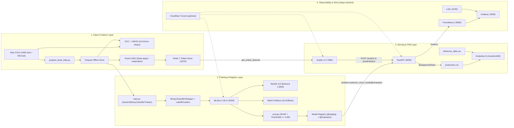
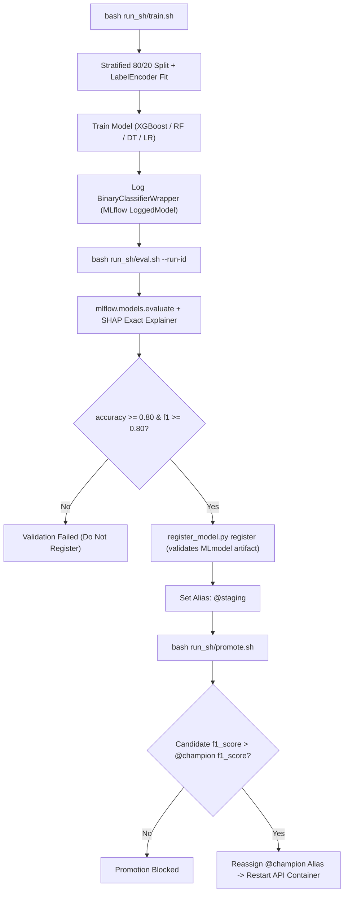
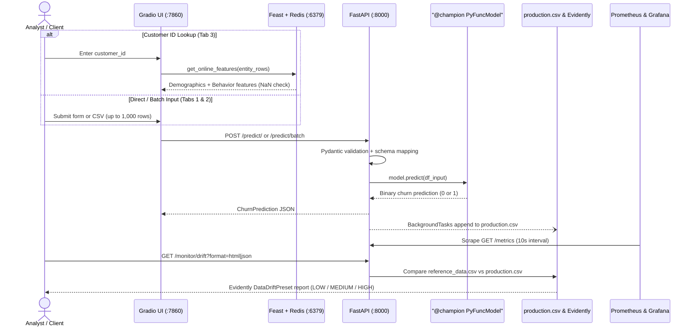

# Customer Churn Prediction — End-to-End MLOps Platform

[](https://www.python.org/downloads/)
[](https://xgboost.readthedocs.io/)
[](https://mlflow.org/)
[](https://feast.dev/)
[](https://fastapi.tiangolo.com/)
[](https://www.evidentlyai.com/)
[](https://www.docker.com/)
[](https://kubernetes.io/)

> A containerized, production-oriented MLOps platform for **customer churn prediction**—combining versioned datasets (DVC + MinIO), dual offline/online feature serving (Feast + Redis), reproducible training with bundled preprocessing (XGBoost / Scikit-learn + MLflow `LoggedModel`s), automated champion/challenger gating, real-time & batch inference (FastAPI + Gradio), and full-stack observability (Evidently AI drift reports, Prometheus, Grafana, and Loki).

---

## Table of Contents

- [1. Executive Summary & Business Context](#1-executive-summary--business-context)
- [2. System Architecture & Visual Diagrams](#2-system-architecture--visual-diagrams)
- [3. Tech Stack & Tooling Rationale](#3-tech-stack--tooling-rationale)
- [4. Methodology & MLOps Techniques](#4-methodology--mlops-techniques)
- [5. Architectural Trade-offs & Engineering Decisions](#5-architectural-trade-offs--engineering-decisions)
- [6. Challenges Faced & Solutions](#6-challenges-faced--solutions)
- [7. Project Structure & Quickstart](#7-project-structure--quickstart)

---

## 1. Executive Summary & Business Context

Customer retention is directly tied to recurring revenue: acquiring a new subscriber typically costs multiples of retaining an existing one, while late-stage churn signals (rising support tickets, payment delays, declining usage frequency) often go unnoticed until cancellation.

This platform operationalizes churn risk scoring as an automated, auditable ML lifecycle rather than an ad-hoc notebook:

- **Zero Train-Serve Skew:** Categorical encoders and feature selection are packaged directly inside a custom `mlflow.pyfunc.PythonModel` (`BinaryClassifierWrapper`) alongside the trained estimator.
- **Sub-Second Feature Lookup & Inference:** Customer profiles are materialized into **Redis** via **Feast** for low-latency online retrieval and served behind a **FastAPI** REST API (`/predict/`, `/predict/batch`) and a 3-tab **Gradio** web application.
- **Controlled Model Promotion:** Candidate models must pass `mlflow.models.evaluate` threshold gates (`accuracy_score >= 0.80`, `f1_score >= 0.80`) and strictly outperform the incumbent `@champion` on `f1_score` before replacing the production alias.
- **Continuous Drift & Service Observability:** Every prediction request is logged asynchronously via FastAPI `BackgroundTasks` for **Evidently AI** feature/prediction drift analysis, while **Prometheus**, **Grafana**, and **Loki** monitor API health, latency, and container logs.

### At a Glance

| Dimension | Verified Details |
| :--- | :--- |
| **Problem Type** | Binary classification (`churned`: `0 = Active`, `1 = Churn`) |
| **Dataset Scale** | `440,833` training rows (`customer_churn_dataset-training-master.csv`), `64,374` holdout test rows (`customer_churn_dataset-testing-master.csv`) |
| **Model Candidates** | XGBoost (`config.yaml`), Random Forest, Decision Tree, Logistic Regression (`GenericBinaryClassifierTrainer`) |
| **Promotion Gate Thresholds** | `accuracy_score >= 0.80`, `f1_score >= 0.80` (`config.yaml`) |
| **80/20 Validation Metrics** | `[TBD: insert train_accuracy, test_accuracy, f1_score, roc_auc from MLflow run]` |
| **Holdout Output (`prediction11.csv`)** | `64,374` rows — Recall: `0.9987`, F1: `0.6558`, Precision: `0.4882`, Accuracy: `0.5034` *(reflects distribution shift between Kaggle train/test files)* |
| **API Latency (p50 / p95)** | `[TBD: insert observed latency from Prometheus /metrics]` |
| **Core Stack** | Python `3.11`, DVC, Feast + Redis, MLflow + MySQL + MinIO, FastAPI, Gradio, Evidently, Prometheus, Grafana, Loki, Docker Compose, Kubernetes |
| **Infrastructure Status** | Docker Compose stack & K8s manifests implemented; Airflow `3.1.0` & 3-broker Kafka `8.0.0` (KRaft) provisioned for scheduled/streaming extensions (DAGs dir currently empty) |

---

## 2. System Architecture & Visual Diagrams

### High-Level Platform Overview (Original Diagram)

```
┌─────────────────────────────────────────────────────────────────┐
│                      MLOps Infrastructure                       │
├─────────────────────────────────────────────────────────────────┤
│                                                                 │
│  ┌───────────────────┐      ┌──────────────────┐                │
│  │  Data Pipeline    │      │  Model Pipeline  │                │
│  ├───────────────────┤      ├──────────────────┤                │
│  │ • DVC (S3/MinIO)  │      │ • MLflow Track   │                │
│  │ • Feast Features  │─────▶│ • XGBoost Model  │                │
│  │ • Redis Online    │      │ • Model Registry │                │
│  └───────────────────┘      └────────┬─────────┘                │
│           │                          │                          │
│           │                          ▼                          │
│           │                  ┌──────────────────┐               │
│           └─────────────────▶│ Serving Pipeline │               │
│                              ├──────────────────┤               │
│                              │ • FastAPI        │               │
│                              │ • Gradio UI      │               │
│                              │ • Monitoring     │               │
│                              └──────────────────┘               │
│  ┌────────────────────────────────────────────────────────────┐ │
│  │              Infrastructure Services                       │ │
│  ├────────────────────────────────────────────────────────────┤ │
│  │ PostgreSQL | MinIO | MLflow | Kafka | Airflow | Monitoring │ │
│  └────────────────────────────────────────────────────────────┘ │
│                                                                 │
└─────────────────────────────────────────────────────────────────┘
```

### End-to-End MLOps Architecture



**How to read it in 30 seconds:** Raw customer records are cleaned, enriched with behavioral ratios, versioned in MinIO via DVC, and materialized into Redis by Feast. Training logs a self-contained `LoggedModel` to MLflow; once `eval.py` verifies performance and `promote.sh` promotes `@champion`, the FastAPI container loads `@champion` at startup, scores requests from Gradio or REST clients, logs inference payloads to `production.csv` for Evidently drift checks, and exports telemetry to Prometheus and Grafana.

---

### Model Training, Evaluation & Champion Promotion Gate



**How to read it in 30 seconds:** Every candidate model goes through two automated gates before reaching production traffic—first an absolute metric floor (`0.80` accuracy and F1 in `config.yaml`), then a relative challenger-vs-champion `f1_score` comparison in `ModelRegistry.promote_model`.

---

### Real-Time Inference & Drift Monitoring Flow



**How to read it in 30 seconds:** Online predictions resolve customer features from Redis in milliseconds (or accept raw inputs directly), run inference on the pre-loaded `@champion` model in memory, and defer CSV persistence to FastAPI `BackgroundTasks` so drift logging never blocks API response time.

---

## 3. Tech Stack & Tooling Rationale

| Layer | Technology | Role in Pipeline | Why Chosen Over Alternatives |
| :--- | :--- | :--- | :--- |
| **Data Versioning** | **DVC `3.67.1` + MinIO** | Tracks raw CSVs and Parquet feature files via `.dvc` pointers in Git with S3-compatible storage (`s3://churn-mlops`). | Keeps multi-megabyte datasets out of Git history while remaining self-hosted and S3-API-compatible (unlike Git LFS or vendor-locked cloud buckets). |
| **Feature Store** | **Feast `0.68.0` + Redis `7`** | Defines `customer_demographics`, `customer_behavior`, and `churn_target` views (`FileSource` offline, Redis online). | Enforces consistent feature schemas between offline training (Parquet) and online lookup (`get_online_features`) without standing up a managed feature platform. |
| **Model Training** | **XGBoost `3.2.0` + Scikit-learn `1.9.1`** | Primary gradient-boosted tree classifier plus RF, Decision Tree, and Logistic Regression baselines. | Tree ensembles capture non-linear churn interactions (`support_calls`, `payment_delay_days`, `tenure_months`) on tabular data with minimal tuning and fast CPU/GPU inference. |
| **Experiment & Registry** | **MLflow `3.18.0` + MySQL `8.0` + MinIO** | Tracks hyperparameters, feature importances, SHAP explanations, `LoggedModel`s, and `@staging`/`@champion` aliases. | Native `pyfunc` packaging + alias-based registry decouples model promotion from API deployments while keeping all metadata/artifacts on local or K8s storage. |
| **Explainability** | **SHAP `0.51.0`** | Computes exact feature attributions (`explainer_type: "exact"`, `max_samples: 100`) during `mlflow.models.evaluate`. | Gives retention teams transparent, auditable churn drivers rather than black-box scores. |
| **Serving & UI** | **FastAPI `0.141.1` + Pydantic `2.14.4` + Gradio `6.32.0`** | Async REST API (`/predict/`, `/predict/batch`, `/health`, `/monitor/drift`) + 3-tab interactive demo UI. | FastAPI gives strict request validation, OpenAPI docs, and `BackgroundTasks`; Gradio provides immediate single, batch, and feature-store lookup UX without front-end boilerplate. |
| **Drift Monitoring** | **Evidently `0.4.36`** | Computes feature distribution drift (`DataDriftPreset`), prediction/target drift (`ClassificationPreset`), and `LOW`/`MEDIUM`/`HIGH` status. | Produces both machine-readable JSON (`DriftMetricsResponse`) for alerting and rich self-contained HTML reports directly from an API route. |
| **Observability** | **Prometheus + Grafana + Loki + Node Exporter** | Scrapes `/metrics` every 10s, ships container logs via Loki Docker driver, and auto-provisions `churn_api_overview.json`. | Standard open-source observability stack with zero external SaaS dependencies and optional `dcgm-exporter` GPU profiling (`--profile gpu`). |
| **Orchestration & Streaming** | **Apache Airflow `3.1.0` + Kafka `8.0.0` (KRaft)** | Pre-provisioned `CeleryExecutor` scheduler/worker and 3-broker ZooKeeper-less Kafka cluster in Docker & K8s. | Ready-to-extend backbone for scheduled retraining DAGs and real-time event ingestion without rewriting infrastructure. |
| **Deployment & Ingress** | **Docker Compose + Kubernetes + Cloudflare Tunnel** | Local multi-stack orchestration on `mlops-network`, K8s manifests (`infra/k8s/`), and zero-trust tunnel (`cloudflare_tunnel/`). | Smooth path from single-machine reproducibility (`./run.sh up`) to cluster deployment (`./deploy.sh`) and HTTPS exposure without opening inbound firewall ports. |

---

## 4. Methodology & MLOps Techniques

### Data Ingestion, Validation & Feature Engineering
- **Preprocessing (`data-pipeline/churn_feature_store/churn_features/feature_repo/prepare_feast_data.py`):** Drops missing records, standardizes column names to snake_case, assigns `event_timestamp` and `created_timestamp`, casts types explicitly (`int64` / `float64`), and computes 5 domain features:
  - `tenure_age_ratio = tenure_months / (age + 1)`
  - `spend_per_usage = total_spend / (usage_frequency + 1)`
  - `support_calls_per_tenure = support_calls / (tenure_months + 1)`
  - `avg_monthly_spend = total_spend / max(tenure_months, 1)`
  - `churn_risk_score = clip(payment_delay_days * 0.3 + (support_calls / max(tenure_months, 1)) * 0.2 + (1 - last_interaction_days / 30) * 0.5, 0, 1)`
- **API Input Validation (`serving_pipeline/api/schemas.py` & `pre_processing.py`):** Pydantic `ChurnInput` enforces strict bounds (`Age` `18–65`, `Tenure` `1–60`, `Usage_Frequency` `1–30`, `Support_Calls` `0–10`, `Payment_Delay` `0–30`, `Total_Spend` `100–1000`, `Last_Interaction` `1–30`) and `Literal` category checks before inference.

### Model Selection, Class Imbalance & Train-Serve Packaging
- **Multi-Algorithm Configs (`model_pipeline/src/config/*.yaml`):** `GenericBinaryClassifierTrainer` (`model_pipeline/src/model/xgboost_trainer.py`) supports `xgboost`, `random_forest`, `decision_tree`, and `logistic_regression` via YAML config swaps.
- **Class Imbalance Handling:** Uses stratified `train_test_split(..., stratify=y)` across all trainers; baseline configs (`random_forest.yaml`, `decision_tree.yaml`, `logistic_regression.yaml`) additionally enable `class_weight: "balanced"`.
- **Self-Contained `PyFunc` Artifact:** `BinaryClassifierWrapper` stores fitted `LabelEncoder`s and `feature_names` alongside the model, infers the MLflow signature on raw DataFrames, and bundles `code_paths=[src]` so inference requires zero external preprocessing scripts.

### Experiment Tracking, Evaluation & Model Registry
- **Tracking (`experiment_tracker.py`):** Logs hyperparameters, `train_accuracy`, `test_accuracy`, top-10 `feature_importance/*` metrics, and model artifacts to MLflow backed by MySQL and MinIO.
- **Automated Evaluation (`eval.py` & `evaluator.py`):** Runs `mlflow.models.evaluate` on `test.parquet`, computes SHAP exact values, validates `MetricThreshold`s (`accuracy_score >= 0.80`, `f1_score >= 0.80`), and optionally saves evaluation predictions as MLflow artifacts.
- **Registry Promotion Gate (`register_model.py` & `model_registry.py`):** Validates that the target run actually contains a `LoggedModel` (`models:/m-<id>`) or `MLmodel` artifact before registering, assigns `@staging` / `@champion` aliases, and gates promotion on strict `f1_score` improvement (`candidate_metric > champion_metric`) queried from evaluation runs tagged with `tags.source_run_id`.

### Serving, Drift Detection & Testing Status
- **FastAPI Serving (`serving_pipeline/api/`):** Pre-loads `MODEL_URI` (`models:/customer_churn_model@champion`) in FastAPI's `lifespan` hook, serves `/predict/` and `/predict/batch` (max `1,000` records), exposes `/health` and `/metrics`, and runs `/monitor/drift` using Evidently `DataDriftPreset` (and `ClassificationPreset` when ground truth + predictions exist in both reference and production datasets), scoring drift as `LOW` (`<= 0.2`), `MEDIUM` (`> 0.2`), or `HIGH` (`> 0.5`).
- **Automation & Testing Status (Honest Scope):**
  - Pipeline automation is driven by modular shell scripts (`infra/docker/run.sh`, `infra/k8s/deploy.sh`, `model_pipeline/src/run_sh/*.sh`); no `.github/workflows` CI pipelines are configured yet.
  - `infra/docker/airflow/dags/` is provisioned and mounted, with DAG scripts yet to be added.
  - `model_pipeline/src/tests/` contains initial unit/integration/E2E test scaffolds (`test_experiment_tracker.py`, `test_integration_training_pipeline.py`, `test_e2e.py`) using mocks and referencing an earlier `XGBoostTrainer` symbol.

---

## 5. Architectural Trade-offs & Engineering Decisions

1. **Bundled `BinaryClassifierWrapper` (`mlflow.pyfunc`) vs. External Feature Transformation Service**
   - *Decision:* Embed `LabelEncoder`s and column ordering inside `BinaryClassifierWrapper` (`model_pipeline/src/model/xgboost_trainer.py`) while keeping schema normalization (`Age` → `age`) in `pre_processing.py`.
   - *Trade-off:* Slightly larger MLflow model artifacts (including `code_paths`), in exchange for eliminating encoder drift between training and FastAPI serving.

2. **Self-Hosted MLflow + MySQL + MinIO vs. Managed Cloud ML Platforms**
   - *Decision:* Run the full tracking/artifact stack locally in Docker (`infra/docker/mlflow/`) and portably in Kubernetes (`infra/k8s/`).
   - *Trade-off:* Requires managing local volumes, buckets (`mlflow`, `churn-mlops`), and Docker networking (`mlops-network`), but avoids cloud vendor lock-in and API costs while mirroring production S3 + RDS topology.

3. **Startup `@champion` Pre-Loading vs. Per-Request Dynamic Model Resolution**
   - *Decision:* Load `models:/customer_churn_model@champion` once during FastAPI `lifespan` startup (`api/main.py`) and restart `churn-prediction-api` when `@champion` changes.
   - *Trade-off:* Zero MLflow network round-trips during inference (low, predictable latency), at the cost of a container restart (`docker restart churn-prediction-api`) on model promotion instead of zero-downtime hot reload.

4. **Shared External Docker Network (`mlops-network`) + K8s Parity vs. Single Monolithic Compose File**
   - *Decision:* Split infrastructure into modular Compose stacks (`mlflow`, `kafka`, `monitor`, `airflow`, `serving_pipeline`) joined via `mlops-network`, paired with dedicated `infra/k8s/` manifests.
   - *Trade-off:* Requires one-time `docker network create mlops-network`, but lets engineers start/restart serving containers or observability independently without bouncing databases or Kafka brokers.

---

## 6. Challenges Faced & Solutions

| Challenge | Root Cause Observed | Implemented Solution |
| :--- | :--- | :--- |
| **Schema Mismatch Between API Clients & Model** | Gradio/API payloads use PascalCase (`Age`, `Tenure`, `Payment_Delay`), whereas Feast and trained models expect snake_case (`age`, `tenure_months`, `payment_delay_days`). | Implemented case-insensitive `map_schema_to_preprocessing()` in [pre_processing.py](serving_pipeline/pre_processing.py) and `map_feature_store_to_api_format()` in [ui.py](serving_pipeline/ui.py). |
| **Feast Online Lookup Returning `None` & `uv` Dependency Backtracking** | Unpinned `requirements.txt` caused `uv` to install `pandas==3.1.1` and backtrack `feast` to `0.20.0` (breaking Pydantic v2); additionally, `feast materialize-incremental` only loaded ~1 day of the 90-day `event_timestamp` range into Redis. | Pinned compatible versions (`feast[redis]==0.68.0`, `pandas==2.3.3`, `pydantic==2.14.4`) in [requirements.txt](requirements.txt) and documented explicit range materialization (`feast materialize 2026-08-01T00:00:00 ...`) in [SETUP_GUIDE.md](SETUP_GUIDE.md). |
| **MLflow 3.x `LoggedModel` Registration Failures** | MLflow 3.18 stores models as `LoggedModel`s (`models:/m-<id>`) rather than `runs:/<id>/model`, and passing an evaluation Run ID silently registered broken versions missing `MLmodel`. | Updated [register_model.py](model_pipeline/src/scripts/register_model.py) to resolve `run.outputs.model_outputs[0].model_id` first and verify an `MLmodel` artifact exists before creating a registry version. |
| **Feast Overriding FastAPI Prometheus `/metrics`** | Feast's `PROMETHEUS_MULTIPROC_DIR` behavior interfered with `prometheus-fastapi-instrumentator`'s default `.expose()` handler. | Instrumented the app via `Instrumentator().instrument(app)` and exposed `/metrics` directly from `prometheus_client.REGISTRY` in [api/main.py](serving_pipeline/api/main.py). |
| **Cold-Start Failures & Latency on First Prediction** | Lazy loading `@champion` on the first HTTP request risked timeouts and masked missing MinIO/MLflow configuration until traffic arrived. | Pre-loaded `predict.get_model()` inside FastAPI's `lifespan` startup hook so misconfigured models fail fast and `/health` reports true readiness. |

---

## 7. Project Structure & Quickstart

### Repository Structure

```
Churn Prediction Project/
├── requirements.txt                  # Pinned root Python dependencies (uv-compatible)
├── SETUP_GUIDE.md                    # Complete fresh-machine runbook
├── data-pipeline/                    # Data versioning (DVC) & Feast feature store
│   ├── churn_feature_store/churn_features/feature_repo/
│   │   ├── churn_entities.py         # Customer entity (INT64 customer_id)
│   │   ├── data_sources.py           # Parquet FileSource definition
│   │   ├── feature_views.py          # Demographics, behavior, and target FeatureViews
│   │   ├── feature_store.yaml        # Redis online store + file offline store config
│   │   └── prepare_feast_data.py     # Cleaning & engineered feature generation
│   ├── data/                         # Raw & processed datasets (.dvc tracked)
│   ├── scripts/                      # EDA notebook & retrieval utilities
│   └── requirements.txt
├── model_pipeline/                   # Training, SHAP evaluation & MLflow Registry
│   ├── prediction_folder/            # Evaluation prediction outputs (prediction11.csv)
│   └── src/
│       ├── config/                   # YAML configs (XGBoost, RF, DT, Logistic Regression)
│       ├── mlflow_utils/             # ExperimentTracker & ModelRegistry
│       ├── model/                    # GenericBinaryClassifierTrainer & ModelEvaluator
│       ├── scripts/                  # train.py, eval.py, register_model.py
│       ├── run_sh/                   # train.sh, eval.sh, register.sh, promote.sh, etc.
│       └── tests/                    # Unit, integration & E2E test scaffolding
├── serving_pipeline/                 # Containerized FastAPI + Gradio + Evidently
│   ├── api/
│   │   ├── main.py                   # FastAPI entrypoint, lifespan model load, /metrics
│   │   ├── schemas.py                # Pydantic request/response & drift schemas
│   │   └── routers/                  # /predict, /health, /monitor/drift
│   ├── pre_processing.py             # Schema mapping, validation, production.csv logger
│   ├── monitoring.py                 # Evidently AI drift report engine
│   ├── load_model.py                 # MLflow PyFunc loader
│   ├── sample_retrieval.py           # Feast online feature retrieval client
│   ├── ui.py                         # Gradio 3-tab web interface
│   ├── Dockerfile & Dockerfile.ui    # API & UI container definitions
│   └── docker-compose.yml            # Serving stack on mlops-network
├── infra/
│   ├── docker/                       # Modular Compose stacks + run.sh orchestrator
│   │   ├── mlflow/                   # MLflow 3.18.0 + MySQL 8.0 + MinIO
│   │   ├── kafka/                    # 3-broker Kafka 8.0.0 (KRaft mode)
│   │   ├── airflow/                  # Apache Airflow 3.1.0 (CeleryExecutor)
│   │   └── monitor/                  # Prometheus, Grafana, Loki, Node & DCGM exporters
│   └── k8s/                          # Kubernetes manifests, deploy.sh, teardown.sh
└── cloudflare_tunnel/                # Optional Cloudflare Tunnel ingress config
```

---

### Quickstart (Local Docker + Python `3.11`)

> For full step-by-step details (including `.env` templates, troubleshooting, and stopping/restarting), see [SETUP_GUIDE.md](SETUP_GUIDE.md).

<details>
<summary><strong>Step 1: Python Environment & Shared Docker Network</strong></summary>

```bash
git clone https://github.com/arpit4101/Churn-Prediction-MLOPS.git
cd Churn-Prediction-MLOPS

# Create Python 3.11 virtual environment and install pinned dependencies
uv venv .venv --python 3.11
source .venv/bin/activate
uv pip install -r requirements.txt

# Create shared external Docker network
docker network create mlops-network
```

</details>

<details>
<summary><strong>Step 2: Start Platform Infrastructure (MLflow, MinIO, Kafka, Airflow, Monitoring)</strong></summary>

Ensure `infra/docker/mlflow/.env`, `infra/docker/airflow/.env`, and `serving_pipeline/.env` (copy from `serving_pipeline/.env.example`) are created first, then run:

```bash
cd infra/docker
chmod +x run.sh
./run.sh up
./run.sh status
cd ../..
```

*(Note: If Docker fails to start containers configured with the `loki` logging driver, install the plugin via `docker plugin install grafana/loki-docker-driver:latest --alias loki --grant-all-permissions`.)*

</details>

<details>
<summary><strong>Step 3: Prepare Data, Version with DVC & Materialize Feast Online Store</strong></summary>

```bash
# Generate Parquet datasets for Feast & evaluation
python data-pipeline/churn_feature_store/churn_features/feature_repo/prepare_feast_data.py \
  --input data-pipeline/data/raw/customer_churn_dataset-training-master.csv \
  --output data-pipeline/churn_feature_store/churn_features/feature_repo/data/processed_churn_data.parquet

python data-pipeline/churn_feature_store/churn_features/feature_repo/prepare_feast_data.py \
  --input data-pipeline/data/raw/customer_churn_dataset-testing-master.csv \
  --output data-pipeline/churn_feature_store/churn_features/feature_repo/data/test.parquet

# Start Feast Redis online store & materialize full 90-day feature window
docker run -d -p 6379:6379 --name redis-feast redis:7
cd data-pipeline/churn_feature_store/churn_features/feature_repo
feast apply
feast materialize 2026-08-01T00:00:00 "$(date -u +%Y-%m-%dT%H:%M:%S)"
cd ../../../..

# Verify Redis online lookup
python serving_pipeline/sample_retrieval.py
```

</details>

<details>
<summary><strong>Step 4: Train, Evaluate, Register & Promote Champion Model</strong></summary>

```bash
cd model_pipeline/src

# 1. Train XGBoost model (note the printed training Run ID)
bash run_sh/train.sh

# 2. Evaluate on holdout test.parquet with SHAP + threshold checks
bash run_sh/eval.sh --run-id <TRAIN_RUN_ID>

# 3. Register LoggedModel in MLflow Model Registry
PYTHONPATH=.. python scripts/register_model.py \
  --config config/config.yaml \
  register \
  --run-id <TRAIN_RUN_ID> \
  --model-name customer_churn_model

# 4. Assign @champion alias to the registered version
PYTHONPATH=.. python scripts/register_model.py \
  --config config/config.yaml \
  set-alias \
  --model-name customer_churn_model \
  --version <VERSION> \
  --alias champion

cd ../..
```

</details>

<details>
<summary><strong>Step 5: Build & Start Serving Stack (FastAPI + Gradio + Drift API)</strong></summary>

```bash
docker compose -f serving_pipeline/docker-compose.yml up -d --build
curl -sL http://localhost:8000/health
```

**Service Endpoints:**
- **Gradio Web UI:** http://localhost:7860
- **FastAPI Swagger Docs:** http://localhost:8000/docs
- **FastAPI Prometheus Metrics:** http://localhost:8000/metrics
- **MLflow UI:** http://localhost:5000
- **MinIO Console:** http://localhost:9001 (`minio` / `minio123`)
- **Grafana:** http://localhost:3000 (`admin` / `admin`)
- **Prometheus:** http://localhost:9090
- **Airflow UI:** http://localhost:8080 (`airflow` / `airflow`)

</details>

---

### Sub-Component Documentation

- [Setup & Fresh Machine Runbook](SETUP_GUIDE.md)
- [Data Pipeline & Feast Feature Store](data-pipeline/README.md)
- [Model Pipeline & Registry](model_pipeline/README.md)
- [Docker Infrastructure Stack](infra/docker/README.md)
- [Kubernetes Deployment Guide](infra/k8s/README.md)
